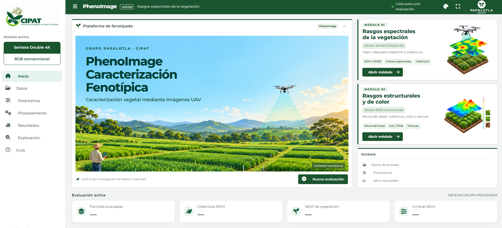

# PhenoImage

### Fenotipado de forrajes mediante imágenes UAV

**CIPAT · Centro de Investigación de Pastos Tropicales · Grupo Papalotla**

<p align="center">
  
</p>



PhenoImage es una aplicación local desarrollada en R/Shiny para la caracterización fenotípica de ensayos de forrajes mediante imágenes obtenidas con vehículos aéreos no tripulados (UAV). Integra módulos para Sentera Double 4K y RGB convencional, con análisis por parcela, visualización de resultados y exportación de productos.

**Distribución privada para evaluación.**

## Capacidades

| Área | Productos y funciones |
|---|---|
| Multiespectral Sentera | Análisis de bandas, índices espectrales configurables y cobertura verde |
| RGB | Análisis de bandas, índices de vegetación y cobertura a partir de imágenes RGB |
| Estructura | Altura del dosel a partir de CHM o de la diferencia entre DSM y DTM |
| Color | Tono, saturación y brillo (HSB), DGCI y componentes CIE-Lab |
| Texturas | Entropía, contraste y homogeneidad mediante matrices GLCM |
| Segmentación y cobertura | Otsu, umbral manual o muestras; clasificación en verde y suelo, con material vegetal seco opcional en el método por muestras |
| Resultados | Tablas por parcela y bases integradas, archivos GeoTIFF y visores interactivos |
| Exploración | Comparación, distribución, relación entre variables y resumen estadístico; vistas Básica, Personalizada y Avanzada |

La selección de análisis permite calcular únicamente los productos requeridos y solicitar los archivos correspondientes. En Exploración, las vistas simplifican la consulta de variables sin modificar los resultados calculados ni las columnas de los archivos exportados. La vista Básica presenta las medias de los rasgos, la altura media y el percentil 90 (P90), así como los porcentajes de cobertura evaluados.

La interpretación científica requiere verificar la calidad de las entradas, la calibración y la correspondencia de los resultados con las condiciones de cada ensayo. Las comprobaciones de funcionamiento del software no sustituyen la validación metodológica.

## Requisitos

- Una instalación de R compatible con las dependencias de la aplicación.
- RStudio para seguir el procedimiento de instalación descrito.
- Conexión a internet para instalar las dependencias y descargar los archivos necesarios.
- Memoria y espacio en disco suficientes para los ortomosaicos y los productos generados.

La función de instalación de dependencias comprueba los paquetes requeridos, entre ellos `terra`, `sf`, `exactextractr` y `pliman`. Los análisis de texturas utilizan además `raster` y `glcm`. Cuando un paquete no dispone de un binario compatible, su instalación puede requerir herramientas de compilación, como Rtools en Windows o bibliotecas del sistema en Linux.

## Instalación para un usuario nuevo

**No se requiere una instalación previa de CIPAT o PhenoImage.**

1. Solicite acceso al repositorio privado y acepte la invitación.
2. En GitHub, seleccione **Code → Download ZIP** y descomprima el archivo completo.
3. En RStudio, detenga cualquier sesión de PhenoImage y seleccione **Session → Restart R**.
4. Abra `INSTALAR_PHENOIMAGE.R` desde la carpeta descomprimida y pulse **Source**.
5. Si aparece un selector de archivos, elija `DESCRIPTION` de esa misma carpeta.
6. Una vez instalado el paquete, ejecute en la consola:

```r
phenoImage::install_dependencies()
```

Espere a que finalice la comprobación e instalación de dependencias. Los ejemplos previamente instalados se conservan en la carpeta de datos del usuario y no son obligatorios para utilizar la aplicación. El procedimiento de instalación no copia ni publica en GitHub los archivos del ensayo.

## Abrir la aplicación

```r
phenoImage::run_app()
```

La interfaz se abre en el navegador y los cálculos se ejecutan en el equipo local. Mantenga R abierto durante el uso de la aplicación y utilice **Stop** para detenerla. Los resultados se guardan en la carpeta seleccionada dentro de PhenoImage.

También puede utilizar:

```r
library(phenoImage)
run_app()
```

Si trabaja con otros paquetes que incluyen una función denominada `run_app`, utilice `phenoImage::run_app()` para identificarla de forma explícita.

## Instalación alternativa desde una versión publicada

Descargue el paquete fuente `.tar.gz` adjunto a la publicación correspondiente en **Releases**. Con la aplicación detenida y la sesión de R reiniciada, ejecute:

```r
install.packages(file.choose(), repos = NULL, type = "source")
phenoImage::install_dependencies()
phenoImage::run_app()
```

Seleccione el archivo `.tar.gz` cuando aparezca el selector. La primera instrucción instala el paquete de la aplicación; la segunda comprueba e instala sus dependencias; la tercera abre PhenoImage.

## Ejemplos opcionales

Puede analizar sus propios datos sin descargar ejemplos. Los ortomosaicos de demostración se distribuyen por separado del código de la aplicación.

Descargue los conjuntos desde [**Datos de ejemplo de PhenoImage**](https://github.com/RiquelmerVelazquez/PhenoImage/releases/tag/datos-ejemplo). En esa publicación encontrará los siguientes archivos:

- `PhenoImage_Ejemplo_RGB.zip`: ortomosaico RGB, CHM y polígonos de parcelas.
- `PhenoImage_Ejemplo_Sentera.zip`: multibanda Sentera y polígonos de parcelas.

Con la aplicación detenida, ejecute:

```r
phenoImage::install_examples()
```

Seleccione el ZIP correspondiente sin descomprimirlo. Repita el procedimiento para el otro módulo si lo requiere y abra nuevamente PhenoImage. Los ejemplos se almacenan en la carpeta de datos del usuario y se conservan al reinstalar el paquete.

Para consultar su disponibilidad:

```r
phenoImage::example_status()
```

Los ejemplos no se descargan ni se sustituyen automáticamente. Para reemplazar expresamente un conjunto instalado, utilice `phenoImage::install_examples(overwrite = TRUE)`.

## Entradas

| Módulo | Entradas principales |
|---|---|
| Sentera | Multibanda con asignación correcta de bandas y polígonos de parcelas identificados; también admite el flujo de ortomosaicos separados disponible en la aplicación |
| RGB | Ortomosaico RGB y polígonos de parcelas identificados; CHM o DSM/DTM cuando se solicita el análisis de altura |
| Solo altura | CHM o DSM/DTM y polígonos de parcelas identificados, sin requerir un ortomosaico RGB |

Los requisitos de entrada se ajustan a los análisis seleccionados. La calidad de los resultados depende de la alineación espacial, el sistema de referencia, las unidades, la asignación de bandas, la escala de los datos y la calibración. Las correcciones y las fórmulas deben corresponder al origen de las imágenes. Consulte los controles de información de la aplicación.

En la segmentación por muestras, la clase de material vegetal seco es opcional. Si no se evalúa, su cobertura se registra como dato no disponible, no como cero. La cobertura total corresponde a verde más seco cuando se utilizan tres clases; con dos clases, coincide con la cobertura verde. Las estadísticas de bandas, índices, color y texturas utilizan la clase verde; el análisis de altura mantiene su filtro independiente.

## Actualizar

Descargue la entrega que desee instalar desde **Releases** y repita el procedimiento correspondiente con PhenoImage detenido y la sesión de R reiniciada. Los ejemplos opcionales y los resultados almacenados fuera de la instalación del paquete se conservan.

Las notas de cada actualización y sus archivos de distribución se consultan en **Releases**. Esta página presenta las características generales de la plataforma y sus procedimientos de uso.

## Método y referencias

- **HSB y CIE-Lab:** conversiones mediante `pliman::rgb_to_hsb()` y `pliman::rgb_to_lab()`.
- **DGCI:** cálculo a partir de los componentes HSB, conforme a la formulación utilizada por `pliman`.
- **Procesamiento ráster y extracción por parcela:** funciones de `terra`, `exactextractr` y código de PhenoImage.
- **Texturas:** cálculo mediante `glcm`, independiente de las conversiones de color.
- **Segmentación por muestras:** clasificación por distancia mínima a prototipos de zonas RGB; su desempeño debe comprobarse con muestras representativas de cada evaluación.

[pliman](https://nepem-ufsc.github.io/pliman/) · [Shiny](https://shiny.posit.co/)

## Autoría y contacto

**Autor y responsable de mantenimiento:** Riquelmer de Jesús Velázquez Hernandez.  
**Contacto:** [rvelazquez@grupopapalotla.com](mailto:rvelazquez@grupopapalotla.com).  
**Vinculación institucional:** CIPAT · Centro de Investigación de Pastos Tropicales · Grupo Papalotla.

PhenoImage se desarrolla como parte de las actividades de análisis de imágenes y fenotipado del área de investigación de CIPAT · Grupo Papalotla.

**Titularidad y condiciones de distribución:** pendientes de definición institucional. El proyecto se mantiene en revisión privada; la licencia se completará con la decisión institucional correspondiente.

## Ayuda

Para informar de un problema, utilice **Issues** del repositorio privado e indique la versión instalada, el módulo, el mensaje de error y los pasos necesarios para reproducirlo. Adjunte únicamente los datos del ensayo que cuenten con autorización para compartirse.

El archivo `VERIFICACION.txt` describe las comprobaciones técnicas realizadas y su alcance. Las publicaciones y los archivos de instalación se encuentran en **Releases** del [repositorio de PhenoImage](https://github.com/RiquelmerVelazquez/PhenoImage).
